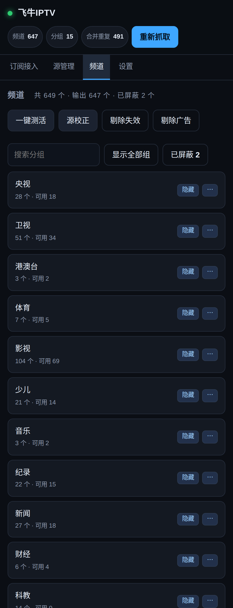
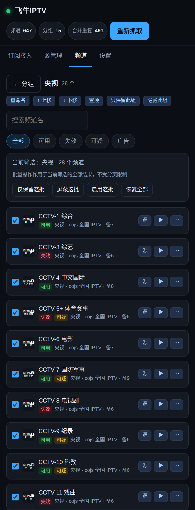
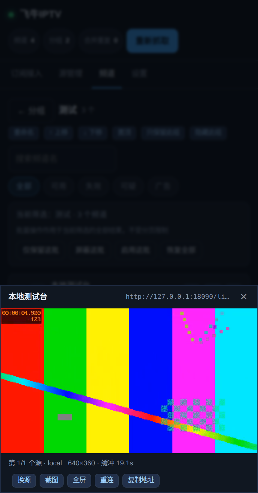
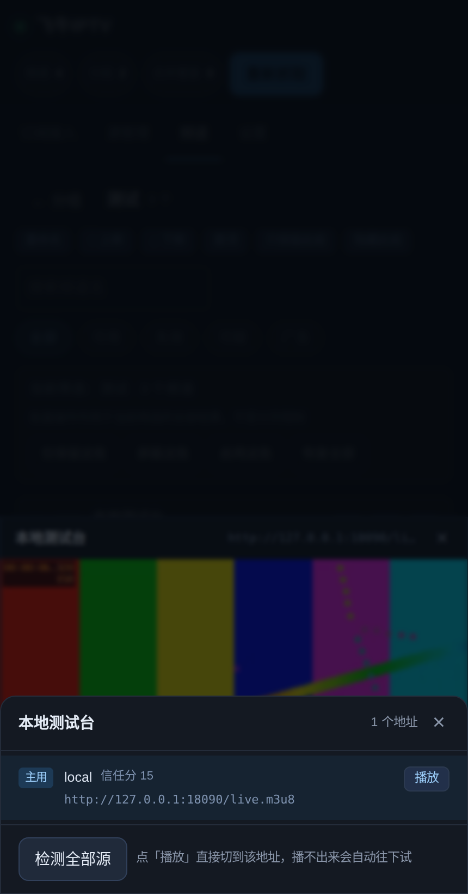

# 飞牛IPTV（fnosiptv）

给**飞牛影视**提供直播源的聚合与分发服务：把多个 M3U / TXT 源抓下来，统一命名、去重、分组，
输出一份干净的 M3U 给飞牛影视导入。自带 Web 管理界面。

**作者**：ranlove99

- 安装包：[`releases/fnosiptv_1.9.0.fpk`](releases/fnosiptv_1.9.0.fpk)（`platform=all`，x86 与 ARM 通用）
- 依赖：只需要飞牛应用中心的 `python312`，无需 Docker、无需 ffmpeg
- 端口：18080
- 协议：见 [LICENSE](LICENSE)

---

## 界面预览

| 分组管理 | 组内频道 |
| --- | --- |
|  |  |

| 播放窗口 | 源面板 |
| --- | --- |
|  |  |

另有[已屏蔽视图](docs/screenshots/blocked.png)与[关于区块](docs/screenshots/about.png)。

---

## 一、为什么需要它

飞牛影视原生支持「电视直播」，可以直接填 M3U 地址。但真实使用时有三个麻烦：

| 麻烦 | 本应用的处理 |
| --- | --- |
| 不同源里同一个台写法不同（CCTV1 / CCTV-1 / CCTV1综合 / CCTV1高清），列表里占四行 | 归一成 `CCTV-1`，同名自动合并，其余源记为备源 |
| 分组名混乱（`央视频道` / `央视` / `News` / `News;Sports`） | 归一成 15 个中文分组，按央视→卫视→港澳台→体育…排序 |
| 源会失效、要手工换地址 | 保留多个源，定时自动重抓；带可用性检测开关 |
| 公开源频道名是英文（`CCTV-StormFootball`），或只有台标号（`CCTV-3`） | 标准频道补中文名：`CCTV-3 综艺`、`CCTV-5+ 体育赛事`；央视各台统一归到「央视」组 |

它**不抓取任何频道**，只整理你提供的源，所以不存在"源从哪来"的问题——你自己加。

---

## 二、装到飞牛

1. 应用中心 → **手动安装** → 选 `fnosiptv_1.9.0.fpk`
2. 装完点启动，桌面会出现「飞牛IPTV」图标
3. 打开后即进入管理界面，首次启动会自动抓取 9 个内置源

管理地址：`http://NAS的IP:18080/admin`

> 装之前如果有旧版本，先卸载再用新包安装；数据在 `/var/apps/fnosiptv/var`，卸载会一起清掉。

---

## 三、接入飞牛影视（三步）

1. 飞牛影视 → **设置 → 新增媒体库**，内容类型选 **电视直播**
2. 直播源类型选 **URL 导入**，粘贴管理界面首页那张卡片上的地址
   `http://NAS的IP:18080/iptv.m3u` —— **必须保留 `.m3u` 后缀**
3. 保存后回首页，出现直播模块即可

三个必须注意的点：

- **地址不能用 127.0.0.1**。界面按你当前访问的地址自动生成，所以请用 NAS 局域网 IP 打开管理页再复制；如果做了反代，在「设置 → 对外地址」里写死（旁边有「填入当前访问地址」按钮）。
- **点「打开预览」只看到黑屏播放器、0:00**：那是浏览器把 `.m3u` 当媒体文件播放了，不是地址错，也不是没内容。1.0.2 起「打开预览」指向 `/preview`（HTML 频道列表），能直接看到抓到了哪些台。直接用浏览器打开 `/iptv.m3u` 仍然是黑屏，属正常。
- **复制出来只有 `/iptv.m3u`、粘进飞牛没内容**：这是 1.0.0 的问题，订阅地址少了主机和端口。1.0.1 已修（前后端都强制拼绝对地址）。临时办法是在「设置 → 对外地址」填 `http://NAS的IP:18080` 再保存。
- **改了源要在飞牛影视里手动刷新直播源**，飞牛不会主动来拉。
- **网页端转圈但电视端正常** = 浏览器跨域限制，不是源坏了。飞牛官方文档给的办法是装 KNAS 浏览器插件，或者直接用飞牛 TV 端看。
- **飞牛影视能打开、播一段就停**：多半是清单或切片带时效签名，播几分钟就过期；也可能拿到的是时移回放流，窗口播完就没了。1.9.0 默认开启「自动续期代理」，频道走本机 `/api/live` 实时重取清单、源过期自动换备源。若仍偶发，通常是该台只有单源且源本身在抖，在频道页多留几个备源即可。

---

## 四、源怎么加 / 频道怎么筛

**内置 9 个源，装完就有 650+ 个频道**，不用自己找：

| 源 | 内容 | 抓取量（实测） |
| --- | --- | --- |
| vbskycn 国内直连 | 央视、卫视、省市县各级台，多为台方自有 CDN | 448 |
| iptv-org 中国 | 国内各级台（含英文名的地方台） | 156 |
| iptv-org 中文 | 全球中文频道 | 228 |
| iptv-org 中国香港 / 中国台湾 / 中国澳门 | 港澳台 | 18 / 34 / 7 |
| cojs 全国 IPTV | 各省运营商单播地址，跨省多半不通，作备源 | 421 |
| fanmingming IPv6 | 国内 IPv6 源，需要网络支持 IPv6 | 82 |
| iptv-org 体育 | 全球体育（默认只留中文名） | 538 |

原始 1932 条去重合并后 **652 个频道 / 15 个分组**，实测 451 个可播（69%）。
内置源全在「源管理」里，可以单条停用或删除；升级不会覆盖你的改动。

「源管理」页也能自己加：

- **订阅 URL**：任意 M3U（`#EXTM3U`）或 TXT（`分组,#genre#`）地址
- **粘贴内容**：把源文本直接贴进来，适合从别人那抄来的列表

优先级数字越小越靠前，**同名频道的主地址取优先级高的那个源**，其余源的地址自动进备源列表（测活时主地址挂了会顶上）。

**频道管理（哪些台进入播放链接）**：频道页是两层结构——先看分组，点进去再管组内的台。

分组列表每行显示该组的台数、可用数、广告数，右侧两个按钮：`隐藏` / `⋯`。
`⋯` 里有重命名、上移、下移、置顶、置底、只保留此组、隐藏此组。
**隐藏整组 = 组内所有台一次性退出播放链接**，恢复也只要点一下，不用逐个勾。

组内页面做的事：

| 操作 | 效果 |
| --- | --- |
| 勾选框 | 取消 = 屏蔽单个台，立即生效 |
| 频道卡 `⋯` → 改名 | 改播放器里显示的名字；M3U 的台名同步，台标仍按原名取 |
| 频道卡 `⋯` → 上移 / 下移 / 置顶 / 置底 | 调整组内顺序，**M3U 里的排列顺序跟着变** |
| 组顶栏 上移 / 下移 / 置顶 | 调整整个分组在 M3U 里的先后 |
| 组顶栏 只保留此组 | 其余分组全部隐藏，快速做一套「只要央视 + 卫视」的订阅 |
| 组顶栏 隐藏此组 | 整组退出，随时可从分组列表恢复 |

屏蔽与隐藏都用黑名单存储（`blocked` / `hidden_groups`），重抓、新增源都不会把没动过的台误删。
顺序与别名单独存（`channel_order` / `group_order` / `name_alias` / `group_alias`），
重抓后依然生效，不会因为刷新一次就白调。

筛选标签除「全部 / 可用 / 失效 / 可疑 / 广告」外多了一个 **「已屏蔽」**，被屏蔽的台集中在这里，
显示屏蔽原因（手动 / 测活失效 / 判定广告 / 仅保留）和来源，勾上即恢复——屏蔽不是单向操作。

列表上方的批量条对**当前筛选的全部结果**生效，不只是已加载的 60 条：

| 按钮 | 作用 | 典型用法 |
| --- | --- | --- |
| 仅保留这批 | 只让这批进入播放链接，其余全部屏蔽 | 搜「CCTV」→ 仅保留；或筛「可用」→ 仅保留 |
| 屏蔽这批 | 把这批全部屏蔽 | 筛「广告」→ 屏蔽这批；某分组整体不要 |
| 启用这批 | 把这批从屏蔽名单里移出 | 在「已屏蔽」里按分组挑回来 |
| 恢复全部 | 清空屏蔽名单 | 改乱了重来 |

「仅保留」等价于白名单，但底层仍是黑名单，所以之后新增的源、新出现的台不会被静默丢掉，
只会在下一次刷新时进入「全部」——想收紧就再点一次「仅保留」。

**一键测活**：频道页点「一键测活」，后台并发探测所有频道的播放地址（先 HEAD，可疑时再 GET 读前 2KB，
能识别"200 但返回网页"的假活；证书过期的源会降级重探一次，因为播放器其实照播）。进度实时显示，结束后每个台标出 `可用 / 失效`，
可点「剔除失效」把死链加入黑名单，或勾「只输出可用频道」让 M3U 只保留活的。
主地址失效时会自动尝试备源，活的那个换到主位——顺手修掉一批死链。

**源校正（识别广告 / 假台）**：公开源里有一类「蹭台号」的地址——标题写着 CCTV-2，点开却是一条
「半价抢购热线 400-xxx」的循环广告片。测活判断不了这个（流是通的），所以单独做了一层校正：

1. **抓取时自动排序**：同一个台往往有七八个地址，按信任分选主地址，不用你操作。

   | 特征 | 加减分 |
   | --- | --- |
   | 运营商 IPTV 网关（`tsfile/live`、`key=txiptv`、`PLTV`、`channels/lantian`） | +45 |
   | 裸 IP + 非标端口（自建转发） | +15 |
   | `/live/cctv2hd.m3u8` 这类「台名+hd」命名（转播站惯用） | −35 |
   | 随机 UUID 文件名 | −45 |
   | `memfs` / `restream` / `_output_`（视频文件转流） | −60 |
   | 一个域名挂 30+ 个台且没有鉴权特征（批量轮播站） | −30 |

   实测效果：CCTV-1~17 的主地址从美国 VPS 上的转播站换成了运营商网关；`AnhuiTV` 只有一个
   `restream.pdtvhd.com/memfs/<uuid>` 地址，得分 −105，直接标成广告。

2. **点「源校正」做深度检查**（650 个台约 90 秒，抓取后会自动跑一次）：逐个拉 m3u8 看结构——
   带 `#EXT-X-ENDLIST` 的是录播文件冒充直播，只有 1~2 个切片的是循环短片，
   多个不同台指向同一条流（切片命名指纹相同）说明至少有一个标错了。
   判为广告的台如果还有备源，会先自动换到能正常直播的地址再下结论。

结果在频道页用 `广告` / `可疑` 徽标标出，点顶部筛选可单独查看；
「剔除广告」一键拉黑，设置里「只输出可信源」可让 M3U 直接不带这些台。

> 说明：判断基于地址特征和播放列表结构，不解析视频画面，所以是「高概率」而非「确诊」。
> 同一个台的别名（余姚综合 / 余姚新闻综合）共用一路信号属正常，不会误报。

**台标**：M3U 里的 `tvg-logo` 指向本机 `/logo/<slug>.png`，服务端先从
[fanmingming 台标库](https://github.com/fanmingming/live) 经 jsDelivr 抓取，失败再回退原始地址，
抓到后缓存到磁盘。这样飞牛影视不需要能访问 imgur 这类外网图床也能显示缩略图。

如果你已经在跑 [`akiralereal/iptv`](https://github.com/akiralereal/iptv) 这类容器（能抓央视频、咪咕、各地广电），
把它的 `/interface.m3u` 地址加进来即可：容器负责抓，本应用负责统一命名和分发，两者互补。

### 单个频道：换源与试播

频道卡片右侧有两个按钮。

**源** —— 列出这个台的全部地址（主源 + 备源），每行标出来源、信任分和测活状态：

| 操作 | 效果 |
| --- | --- |
| 检测全部源 | 逐个探一遍，失效的给出具体原因（`Connection refused`、`Network unreachable`） |
| 用这个 | 把这条备源提为主源，原主源退回备源列表 |
| 播放 | 直接看这个源里到底放的是什么 |

手选的地址会记住：重新抓取后按地址自动恢复（找不到才放弃），卡片上标一个「手选」。
主源挂掉时测活会自动换备源，但你手选过的优先级更高，不会再被换回去。

**▶** —— 弹出播放窗口。

播放不直连源站，走本机 `/api/stream` 代理：m3u8 拉下来把切片和子清单地址重写成
`/api/seg?u=...`，分片边下边转、透传 `Range`。这么做是因为浏览器有两条硬限制——
Chrome 不认 m3u8（包内自带 hls.js 来解），第三方源基本不给 CORS 头（直连会被拦）。

> **给飞牛影视的订阅走 `/api/live`**：`/iptv.m3u` 里每个 m3u8 频道都指向
> `/api/live?u=<主源>`。播放器每次取清单都实时重取，主源签名过期、时移窗口播完时
> 自动换下一个备源；切片 403/404 就把该源标记冷却。这就是 1.9.0 治「能打开、播一段就停」的机制。

**播不出来会自己往下换源**。点 ▶ 时先问 `/api/play` 要一份候选顺序：

```
可用 → 未测 → 失效        同一档里：主源优先，其次信任分高的
```

按这个顺序依次试，某个源清单拉不到、切片 404、或者 9 秒还没出画面，就自动跳下一个，
底栏会写「第 2/5 个源」。全部试完才报失败，并给出原因（清单拉不到 / 切片超时）和「重试 / 换个源」。
不用再一个个手点——649 个台里大部分只有一两个能播，这是最省事的方式。

播放窗口里还能做：

| 按钮 | 用途 |
| --- | --- |
| 换源 | 就地打开源面板，点某个地址直接切过去，不用关掉播放器 |
| 截图 | 把当前画面存成 JPG，用来确认这个源到底播的是什么内容（判断广告最直接） |
| 全屏 | 全屏看，手机上会调起系统全屏 |
| 重连 | 同一个源重新拉一次，网络抖一下不用退出 |
| 复制地址 | 复制这个源的原始地址，拿到别处验证 |

底栏实时显示分辨率、码率、缓冲秒数、丢帧数；多码率的源会出现清晰度下拉（自动 / 720p / 1080p）。
播放时会申请屏幕常亮，手机不会看到一半黑屏；音量记在本机，下次打开沿用。

代理层的几个细节（这决定了「能不能播」）：

- **源过期自动续期换源**：切片返回 403/404/410 时把当前源标记冷却（90 秒），
  播放器重载清单时直接跳过它换下一个可用源；单源频道不受影响（没得换就继续用）；
- **302 跳转后用最终地址做相对路径基准**，否则跳转后切片一律 404 —— 很多源站会把 m3u8 跳到 CDN 目录；
- 切片失败重试一次，上游 404 原样返回（播放器据此换源，比吞掉有用）；
- 切片带 20 秒私有缓存，回看/拖回去时不重复跨境拉；
- 证书链有问题的源降级重试，播放器其实照播。

> 如果所有源都提示「清单拉不到」，多半是运营商网关跨省不通，换台或换个时间再试。

---

## 五、设置项

| 项 | 默认 | 说明 |
| --- | --- | --- |
| 统一频道显示名 | 开 | CCTV1 / CCTV-1 / CCTV1综合 → CCTV-1 |
| 同名去重 | 开 | 一个频道只留一个源，其余记为备源 |
| 仅保留中文频道 | **开** | 公开源里海外台极多（iptv-org 体育源 540 个），不开会淹没列表 |
| 定时刷新 | 360 分钟 | 0 = 不自动刷新 |
| 抓取超时 | 30 秒 | 大列表（500+ 频道）15 秒不够；抓取失败会自动重试一次 |
| EPG 地址 | 空 | 填 XMLTV 地址后合并，M3U 头部带 `x-tvg-url` |
| 对外地址 | 空 | 留空取当前访问地址；反代/端口映射时填死 |
| 刷新时检测可用性 | 关 | 抓取后顺带探测前 400 个，比手动测活慢 |
| 隐藏离线频道 | 关 | 依赖上一项 |
| 台标走本机代理 | **开** | 关掉则 M3U 用源里的原始台标地址（很多是 imgur，国内打不开） |
| 自动续期代理（防中途停） | **开** | `/iptv.m3u` 里的 m3u8 频道改走本机 `/api/live`：实时重取清单、源过期自动换源，治飞牛影视「播一段就停」；代价是流量过一遍 NAS |
| 多源自动切换 | **开** | 主源失效时自动换备源；关掉则只代理你手选的那一个源 |
| 只输出可用频道 | 关 | 测活后生效；没测过的频道仍保留 |
| 频道页隐藏已屏蔽 | **开** | 关掉后已屏蔽的台仍出现在「全部」里并带标签，方便对照 |
| 屏蔽名单 | 空 | 黑名单（频道名），勾选框取消即加入；「已屏蔽」视图里可逐条恢复 |
| 隐藏分组 / 分组顺序 / 别名 | 空 | 由频道页的分组操作维护，不需要手动填 |

---

## 六、接口

| 路径 | 用途 |
| --- | --- |
| `/admin` | 管理界面 |
| `/iptv.m3u` | M3U 订阅（**给飞牛影视**） |
| `/iptv.txt` | TXT 订阅（DIYP / 百川影音） |
| `/epg.xml` | 合并后的 XMLTV 节目单 |
| `/health` | 健康检查，`cmd/main` 靠它判就绪 |
| `/api/channels?offset=0&limit=60&group=&alive=&ad=&q=&blk=` | 频道分页；`blk=1` 只看已屏蔽 |
| `/api/manage` | 频道管理：`op=block / unblock / block_filter / unblock_filter / only / unblock_all` |
| `/api/groups` | 分组列表（台数、可用数、广告数、是否隐藏） |
| `/api/group` | 分组操作：`action=rename / hide / show / only / show_all / move / top / bottom` |
| `/api/channel/order` | 组内排序：`{name, delta}` 或 `{name, to:"top"/"bottom"}` |
| `/api/channel/rename` | 频道显示名：`{name, alias}`，`alias` 为空则恢复原名 |
| `/logo/<hex>.png` | 台标代理（M3U 里的 `tvg-logo` 指向这里） |
| `/api/probe` · `/api/probe/status` · `/api/probe/prune` | 测活：启动 / 进度 / 剔除失效 |
| `/api/channel?name=` | 单个频道的全部源及各自测活状态 |
| `/api/channel/probe` · `/api/channel/pick` | 检测该频道所有源 / 把某个地址设为主源 |
| `/api/play?name=` | 播放候选顺序（可用 → 未测 → 失效，同档内主源优先、信任分高的在前） |
| `/api/live?u=` | 频道稳定播放入口：实时重取清单 + 源过期自动换源（M3U 里每个 m3u8 频道都指这里） |
| `/api/stream?u=&s=` · `/api/seg?u=&s=` | HLS 代理：改写后的清单 / 分片转发（`u` 是 base64url 地址，`s` 标记所属源，用于失败换源） |

支持 `?tab=src|ch|set` 直达管理页某个页签。

---

## 七、已知限制（重要）

1. **没有在真实 fnOS 设备上验证过。** 生命周期脚本（start/status/stop）已在等价的 Linux 环境完整跑通：启动、就绪探针、`status` 返回 0、停止后返回 3、端口释放、无残留进程；但"应用中心手动安装 → 桌面图标 → 卸载"这一段需要你在真机上走一遍。
2. **飞牛影视是否读取 M3U 里的 `x-tvg-url`（节目单）不确定。** EPG 主要保证 TiviMate / Kodi 这类播放器可用；飞牛影视内的节目单显示以你实际版本为准。
3. **默认源质量一般。** 公开源实测 652 个频道里约七成地址活着（vbskycn 源贡献最多），其余要测活后剔除。长期使用建议换成自己的源。
4. **1.9.0 起订阅默认走本机代理。** `/iptv.m3u` 里的 m3u8 频道指向 `/api/live`，
   实时重取清单、源过期自动换源；代价是流量过一遍 NAS，且需要 NAS 对播放设备可达。
   关掉「自动续期代理」即恢复直连原始地址。

---

## 八、从源码构建

仓库里保留完整的 FPK 打包结构，无需额外依赖（标准库 + `tar` 即可）：

```bash
git clone https://github.com/ranlove99/fnosiptv.git
cd fnosiptv
./build.sh
```

脚本读取 `pack/manifest` 里的版本号，生成 `releases/fnosiptv_<版本>.fpk`，并打印包内条目与 MD5。
打包时的两个硬性要求已经固化在脚本里：程序压缩包必须叫 `app.tgz`；包内路径必须是裸相对路径，
不能带 `./` 前缀，否则飞牛安装时会报「解压 app.tgz 失败」。

开发调试可直接跑源码（不写入系统目录）：

```bash
TRIM_PKGVAR=/tmp/fnosiptv-data FNOSIPTV_PORT=18099 python3 pack/app/fnosiptv.py
# 打开 http://127.0.0.1:18099/admin
```

## 九、项目结构

```
fnosiptv/
├── .gitignore
├── LICENSE                    MIT
├── README.md
├── build.sh                   打包脚本：pack/ → releases/*.fpk
├── releases/
│   └── fnosiptv_1.9.0.fpk     可直接手动安装的成品
├── docs/screenshots/          界面截图
└── pack/                      FPK 原始目录
    ├── manifest               版本、作者、端口等元信息
    ├── cmd/                   飞牛生命周期脚本（start/status/stop/回调）
    ├── config/                权限与资源配置
    ├── wizard/install         安装向导
    ├── ICON*.PNG              应用图标
    └── app/
        ├── fnosiptv.py        HTTP 服务、路由、管理接口、HLS 代理
        ├── iptvcore.py        源抓取、解析、评分、探测、输出
        └── ui/
            ├── index.html     单页管理界面（频道 / 分组 / 源 / 播放 / 设置）
            ├── hls.min.js     hls.js 1.5.17（浏览器端 HLS 解码）
            ├── config         界面配置
            └── images/        界面图标
```

运行期数据不在仓库里：安装后的 `cache.json`（频道与测活结果）、`config.json`（设置与屏蔽名单）
落在飞牛应用的 `var` 与 `etc` 目录，卸载前请自行备份。
